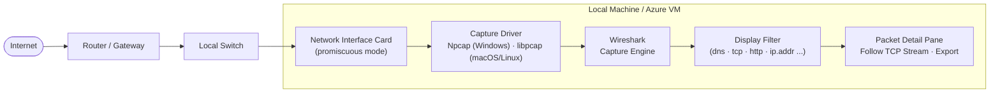
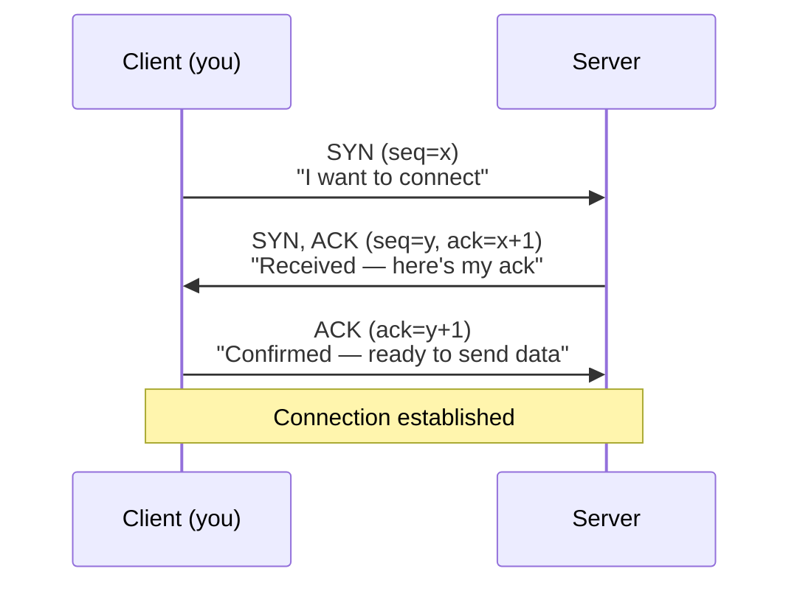
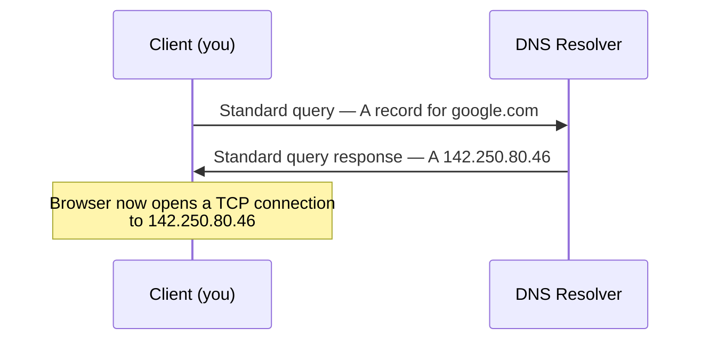

 Lab 2 — Wireshark & Network Analysis
 
**Reading the wire: packet capture, protocol analysis, and why HTTPS exists.**
 


 
| Field | Value |
|---|---|
| Certification alignment | CompTIA Network+ · Security+ · CySA+ |
| Free tools | Wireshark — free and open source, no expiration, no account required |
| Time to complete | 2–4 hours across multiple sessions |
| Estimated cost | $0 — Wireshark is permanently free |
| Career relevance | Network Engineer · SOC Analyst · Cloud Security Engineer · Incident Responder |
 
---
 
## Overview
 
Networks carry every piece of data an organisation produces — emails, database queries, login credentials, file transfers, API calls. When something breaks — a service is unreachable, a user reports slow performance, a security alert fires — the network is almost always involved. The only way to know what's actually happening is to look at the packets.
 
This lab captures live traffic with Wireshark and works through the core analysis skills used daily in network and security operations: reading a TCP handshake, tracing a DNS lookup, filtering a noisy capture down to the packets that matter, spotting cleartext credentials in unencrypted HTTP, and reconstructing a full conversation from individual packets.
 
| Role | How this lab applies |
|---|---|
| Network Engineer | Diagnose connectivity issues by seeing exactly where packets are dropped or delayed |
| SOC Analyst | Identify malicious traffic patterns, extract indicators of compromise from packet captures |
| Cloud Security Engineer | The mental model from Wireshark transfers directly to reading Azure Network Watcher and VPC flow logs |
| Help Desk | Prove a reported network issue is real, and identify whether it's client-side or server-side |
 
---
 
## Architecture
 
### How traffic reaches Wireshark
 

 
Wireshark doesn't generate or inject traffic — it asks the OS's capture driver to hand it a copy of every frame crossing the interface. On a switched network you'll mostly see your own machine's traffic plus broadcast traffic, since a switch only forwards unicast frames to their intended port. Capture filters (applied by the driver, before recording) limit what gets written; display filters (applied by Wireshark, after capture) only limit what you *see* — the full capture is always still there underneath, which is why this lab uses display filters throughout.
 
### The TCP three-way handshake
 

 
If you see a SYN with no SYN-ACK reply, the connection was refused or the host is unreachable. A RST packet means the connection was forcibly closed. These two patterns are the first thing network engineers look for when diagnosing connectivity failures.
 
### A DNS lookup
 

 
Every website visit, API call, and app connection starts with a DNS lookup like this one. An unexpected query to an unfamiliar domain in a capture is often the first visible sign of malware calling home to a command-and-control server.
 
---
 
## Key Concepts
 
**Packet.** A small unit of data traveling across a network. Data you send — an email, a web page request — is broken into many packets, each with a header (source IP, destination IP, port) and a payload. Packets can take different routes and are reassembled at the destination. Wireshark captures and displays each one individually.
 
**Protocol.** A set of rules defining how data is formatted and transmitted. DNS resolves domain names to IPs, HTTP transfers web content, TCP guarantees reliable delivery, ICMP handles diagnostics like ping. Each has its own port and packet structure, which is what makes protocol-based filtering possible.
 
**HTTP vs. HTTPS.** HTTP is unencrypted — anyone who can see the traffic can read every request and response, including credentials submitted in a login form. HTTPS adds TLS encryption on top, so captured packets are unreadable even if intercepted. This lab includes a hands-on demonstration of exactly why that distinction matters.
 
**Promiscuous mode.** Normally a NIC only captures packets addressed to your machine. In promiscuous mode it captures every packet on the segment it can see, regardless of destination. Wireshark enables this automatically on capture start. On a modern switched network this mostly surfaces your own traffic plus broadcasts; hub-based networks or a port-mirrored switch expose more.
 
---
 
## What You'll Learn
 
| Skill | Real-world application |
|---|---|
| Capture live network traffic | The foundational skill — you can't analyse what you can't see |
| Apply display filters | Production captures generate millions of packets; filters find the 10 that matter in seconds |
| Read TCP handshakes | Distinguishing a successful connection from a refused or unreachable one, at a glance |
| Identify DNS queries and responses | DNS underlies nearly every network action — this transfers directly to cloud DNS troubleshooting |
| Spot cleartext credentials in HTTP | A hands-on demonstration of why HTTPS matters |
| Follow TCP streams | Reassembling a full conversation from individual packets — essential for incident investigation |
 
---
 
## Prerequisites
 
- A machine you're authorised to capture traffic on (your own local machine or an Azure VM you control)
- Administrator/root privileges to install a packet capture driver
- No account, licence, or payment required — Wireshark is free and open source
> **Scope and ethics:** every exercise below captures traffic on a network and system you own or have explicit permission to analyse. Capturing traffic on a network you don't own or control — even "just to look" — can be illegal depending on jurisdiction and policy. Exercise C in particular (cleartext credential capture) is built against a test login form you control, never a live third-party service.
 
---
 
## Step 1 — Install Wireshark
 
Download from [wireshark.org/download.html](https://www.wireshark.org/download.html) — no account, no trial, no licence.
 
| OS | Download | Notes |
|---|---|---|
| Windows | Windows x64 Installer (.exe) | Accept defaults. Install **Npcap** when prompted — required to capture packets |
| macOS | macOS Arm or Intel (.dmg) | Run the installer. If prompted about **ChmodBPF**, allow it — grants Wireshark access to network interfaces |
| Linux | Package manager | `sudo apt install wireshark` (Ubuntu/Debian). Add yourself to the `wireshark` group to capture without root |
 
```bash
# Linux only — add yourself to the wireshark group (log out and back in after)
sudo usermod -aG wireshark $USER
 
# Verify installation
wireshark --version
```
 
---
 
## Step 2 — Your First Capture
 
Get comfortable with the interface before doing anything complex.
 
1. Open Wireshark — the welcome screen lists network interfaces with live wavy-line traffic activity
2. Double-click your active interface (Ethernet or Wi-Fi — pick the one with the most wave activity)
3. Wireshark starts capturing immediately — packets appear in real time
4. Open a browser and visit any website
5. After ~30 seconds, click the red **Stop** square in the toolbar
You now have a capture in memory containing every frame that crossed that interface during the window — likely hundreds or thousands of packets from 30 seconds of browsing. This volume is exactly why display filters exist.
 
---
 
## Step 3 — Essential Display Filters
 
Type into the filter bar at the top of the window and press Enter — the packet list updates instantly.
 
> **Capture filters vs. display filters:** capture filters are applied *before* recording and limit what's captured. Display filters are applied *after* capture and limit what you *see*, without discarding anything. This lab uses display filters throughout — apply `dns`, look at DNS traffic, remove it, apply `tcp`, look at something else — the full capture is always there underneath.
 
| Filter | What it shows | When to use it |
|---|---|---|
| `dns` | All DNS queries and responses | Troubleshooting name resolution, spotting unusual domain lookups |
| `http` | Unencrypted HTTP traffic only | Finding cleartext data, debugging web apps without HTTPS |
| `tcp` | All TCP traffic | Starting point for connectivity investigations |
| `tcp.flags.syn == 1` | TCP SYN packets — connection attempts | Seeing which hosts are trying to connect to what |
| `tcp.flags.reset == 1` | TCP RST packets — connection resets | Finding refused or forcibly closed connections |
| `icmp` | All ICMP traffic, including ping | Verifying basic reachability between hosts |
| `ip.addr == 192.168.1.1` | All traffic to or from a specific IP | Isolating one host in a busy capture |
| `ip.src == 10.0.0.5` | Traffic from a specific source IP only | Isolating outbound traffic from one host |
| `tcp.port == 443` | All HTTPS traffic | Identifying encrypted web traffic by port |
| `http.request` | HTTP GET and POST requests only | Finding web requests — useful for spotting data exfiltration |
 
---
 
## Step 4 — Guided Exercises
 
Work through these in order — each builds on the last.
 
### Exercise A — Capture a DNS Lookup
 
`nslookup` is a built-in command-line tool that manually triggers a DNS lookup — useful here because it generates DNS traffic on demand for Wireshark to capture. It runs in a **separate terminal window**, not inside Wireshark (Wireshark is purely a capture/analysis tool, it has no terminal of its own).
 
Opening a terminal: **Windows** — Win key → type `cmd` → Enter. **macOS** — `Cmd+Space` → type `Terminal` → Enter. **Linux** — right-click desktop → *Open Terminal*, or `Ctrl+Alt+T`.
 
> An **A record** maps a domain name to an IPv4 address — the most common DNS record type. (AAAA maps to IPv6, MX identifies mail servers, CNAME is an alias.) In the capture, the record type appears as a number — type `1` is an A record.
 
**Steps:**
 
1. In Wireshark, start a capture on your active interface (blue shark-fin icon, or double-click the interface)
2. Leave it running and open a separate terminal
3. Run: `nslookup google.com` — note the IP address(es) returned
4. Switch back to Wireshark → click **Stop**
5. In the filter bar, type `dns` → Enter
6. Find the query packet — Info column shows *"Standard query A google.com"*
7. Find the response packet — *"Standard query response A google.com"*
8. Select the response packet → expand **Domain Name System (response)** in the detail pane → find the **Answers** section → confirm the IP matches what `nslookup` returned
**What you just saw:** your machine queried a DNS server for the A record of `google.com`, and the response IP is what your browser then connects to. This invisible lookup precedes every website visit, API call, and email your machine sends.
 
### Exercise B — Watch the TCP Three-Way Handshake
 
1. Start a capture
2. Visit `http://example.com` in a browser — HTTP, not HTTPS, makes the handshake easier to read
3. Stop the capture
4. Run `nslookup example.com` to get its IP, then filter: `tcp and ip.addr == [that IP]`
5. Find three sequential packets: **SYN → SYN-ACK → ACK**
| Packet | Flags | Meaning |
|---|---|---|
| 1st | SYN | Client: "I want to connect. Here's my sequence number." |
| 2nd | SYN, ACK | Server: "Received. Here's my sequence number. Accepted." |
| 3rd | ACK | Client: "Confirmed. Connection is open." |
 
### Exercise C — Spot Cleartext Credentials (HTTP)
 
> **Educational exercise only.** Capture only on networks and systems you own or have explicit permission to analyse. Never run this against a system you don't own.
 
1. Set up a test HTTP login form on your local machine (or use a test site running over HTTP, not HTTPS)
2. Start a capture
3. Submit the login form with a test username and password
4. Stop the capture → filter: `http.request.method == POST`
5. Click the POST packet → find the **HTML Form URL Encoded** layer in the detail pane
6. The username and password appear in plaintext
This is exactly why every login form must use HTTPS — without TLS, anyone on the network path (an ISP, a coffee-shop router, a man-in-the-middle attacker) can read credentials exactly as typed. It's also how security teams prove the vulnerability exists to developers who resist adding HTTPS.
 
### Exercise D — Follow a Full TCP Stream
 
1. Capture traffic while visiting any HTTP site
2. Find any HTTP packet in the list
3. Right-click → **Follow → TCP Stream**
4. Wireshark reassembles the full conversation — red text is the client's request, blue is the server's response
This is how incident responders reconstruct what happened during a network event — individual packets are fragments; the stream view is the complete conversation.
 
---
 
## Step 5 — Save and Export Captures
 
Save interesting captures — they're both evidence of your work and your portfolio entries for this lab.
 
```bash
# Save a capture for later analysis
File → Save As → choose .pcapng format
 
# Export only the packets matching your current display filter
Apply your display filter first
File → Export Specified Packets → Displayed
 
# Re-open a saved capture
File → Open → select your .pcapng file
 
# Command-line capture with tshark (bundled with Wireshark — useful on remote servers)
tshark -i eth0 -w capture.pcapng -c 1000
# -i: interface name   -w: output file   -c: stop after this many packets
```
 
---
 
## Verification — Confirm the Lab is Working
 
| Skill | How to verify |
|---|---|
| DNS capture | Filter `dns`, identify a query and its response — they share a matching transaction ID |
| TCP handshake | Find three sequential SYN / SYN-ACK / ACK packets — explain each one without notes |
| Display filters | Filter by IP, port, and protocol from memory — no lookup needed |
| Stream reconstruction | Follow a TCP stream and read the full HTTP request/response as a conversation |
| File management | Save a capture, close Wireshark, reopen it, and confirm all packets load back in |
 
---
 
## Troubleshooting
 
| Problem | Fix |
|---|---|
| No interfaces show traffic activity | Confirm you're capturing on the interface actually in use (Wi-Fi vs. Ethernet) — check your OS network settings if unsure |
| "You don't have permission to capture" (Windows) | Reinstall Wireshark and ensure Npcap was selected during setup; Npcap can also be installed standalone from npcap.com |
| "You don't have permission to capture" (Linux) | Add yourself to the `wireshark` group (`sudo usermod -aG wireshark $USER`) and log out/in — or run Wireshark with `sudo` as a fallback |
| macOS capture fails silently | Confirm ChmodBPF was allowed during install; check System Settings → Privacy & Security for blocked permissions |
| No DNS packets appear after `nslookup` | Confirm the capture was running *before* the command executed, and that the terminal and browser are using the same network interface Wireshark is capturing on |
| Can't find the SYN/SYN-ACK/ACK sequence | Some sites redirect HTTP → HTTPS instantly, skipping straight past — use `http://example.com` specifically, it stays on plain HTTP |
| POST data not visible in Exercise C | Confirm the form actually submitted over HTTP, not HTTPS, and that the filter is `http.request.method == POST` exactly |
 
---
 
## Security Considerations & Lessons Learned
 
- **Scope discipline is the whole game.** Every exercise here is bounded to traffic you generated on infrastructure you control. The same skills applied without authorization are a violation of the Computer Fraud and Abuse Act (US) and equivalent laws elsewhere — packet capture on a network you don't own or lack permission to analyse is not a grey area.
- **Cleartext HTTP is a real, visible risk — not a theoretical one.** Exercise C demonstrates in about two minutes why HTTPS-everywhere became the industry default: credentials in an unencrypted form field are trivially readable to anyone positioned on the network path.
- **Display filters over capture filters, by default.** Filtering after the fact preserves the full capture for re-analysis through a different lens — a habit that matters directly in incident response, where you often don't know what you're looking for until partway through the investigation.
- **DNS is a high-value signal.** Because DNS precedes almost every network action, unexpected or unusual queries are one of the fastest ways to spot malware beaconing to command-and-control infrastructure — this is the same lookup-then-connect pattern SOC tooling is built to flag at scale.
- **This mental model transfers directly to the cloud.** Reading a Wireshark capture teaches the same conceptual skill as reading Azure Network Watcher flow logs or AWS VPC Flow Logs — source/destination, protocol, port, and the same handshake/reset patterns, just in log form instead of packet form.
---
 
## Repository Structure
 
```
.
├── README.md
├── captures/
│   ├── dns-lookup.pcapng
│   ├── tcp-handshake.pcapng
│   └── tcp-stream-follow.pcapng
└── screenshots/
    ├── 01-dns-query-response.png
    ├── 02-tcp-three-way-handshake.png
    ├── 03-http-post-cleartext.png
    └── 04-follow-tcp-stream.png
```
 
> Save three captures per the lab's closing guidance — a DNS lookup, a TCP handshake, and a stream follow — and upload them alongside this README as portfolio evidence. **Before committing:** double-check no `.pcapng` file contains real credentials, session tokens, or anything beyond the test data generated for Exercise C.
 
---
 
**Author:** Betredawit Arega
**Lab environment:** Wireshark (latest stable) · Local machine or Azure VM
 
