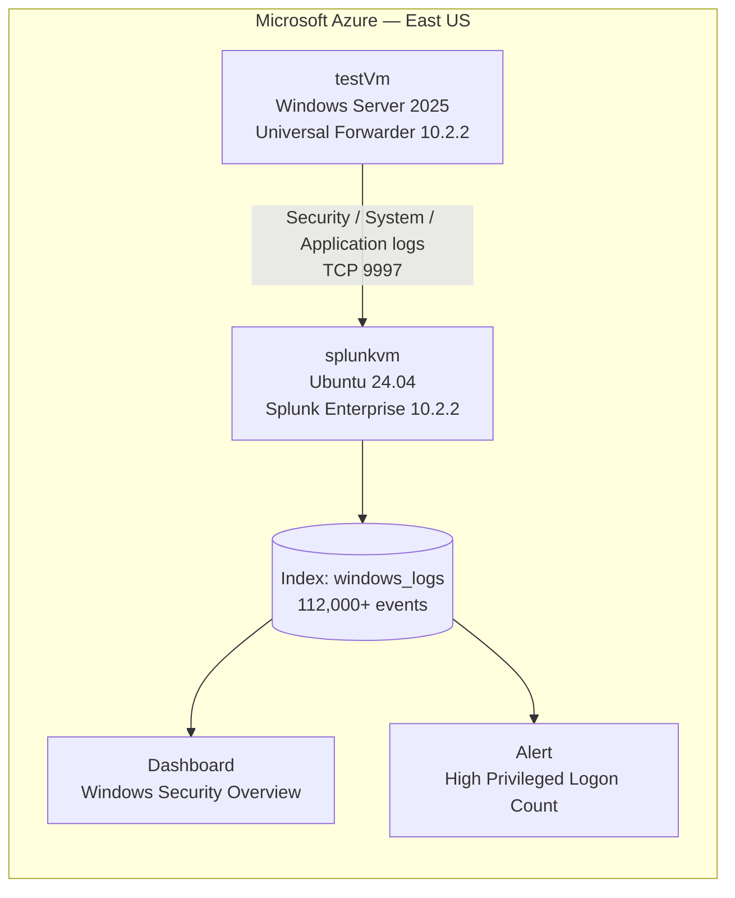

# Lab 3 — Splunk SIEM & Log Analysis on Azure

A Windows Server VM ships its event logs into a Splunk indexer on Azure, where I ran SPL searches, built a security dashboard, and configured a detection alert — the core Tier-1 SOC workflow.

**Skills:** Splunk Enterprise · Universal Forwarder · SPL · dashboards · alerting · Azure VMs
**Aligned with:** CompTIA Security+, CySA+, Splunk Core Certified User (SPLK-1001)

## Architecture



## What was built

1. **Indexer** — Splunk Enterprise 10.2.2 on `splunkvm`, receiver enabled on port **9997**, `windows_logs` index created, Splunk set to start on boot.
2. **Forwarder** — Universal Forwarder 10.2.2 on `testVm`, configured to forward the Security, System, and Application Windows event logs into the `windows_logs` index.
3. **Log generation** — service restarts generated 7036 events; failed-logon activity generated 4625s; normal admin activity produced 4624/4672.
4. **Verification** — 112,000+ events searchable in Splunk:

| EventCode | Meaning | Count |
|-----------|---------|-------|
| 4624 | Successful logon | 13,704 |
| 4625 | Failed logon | 17,322 |
| 4672 | Special privileges assigned to new logon | 13,727 |
| 7036 | Service state change | 8,914 |

## SPL queries used

```spl
| metadata type=hosts index=windows_logs
index=windows_logs | stats count
index=windows_logs EventCode=4625 | stats count by TargetUserName
```

## Dashboard — "Windows Security Overview"

Four panels over the last 24 hours:

1. **Logon Events Over Time** — `index=windows_logs EventCode=4624 OR EventCode=4625 | timechart count by EventCode`
2. **Failed Logons by User** — `index=windows_logs EventCode=4625 | stats count by TargetUserName | sort -count | head 10`
3. **Service State Changes** — `index=windows_logs EventCode=7036 | timechart count by Service_Name`
4. **Privileged Logons** — `index=windows_logs EventCode=4672 | stats count`

## Alert — "High Privileged Logon Count"

- **Search:** `index=windows_logs EventCode=4672 | stats count by TargetUserName | where count > 5`
- **Schedule:** every 5 minutes, window −5m → now
- **Logic:** fires when one user accumulates more than 5 special-privilege logons in 5 minutes — possible privilege misuse or attack.

## What I'd do next

- Add Sysmon for richer endpoint telemetry.
- Build a brute-force detection: burst of 4625s followed by a successful 4624.
- Forward from a second Windows host and compare logon patterns across hosts.
