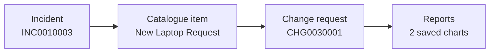
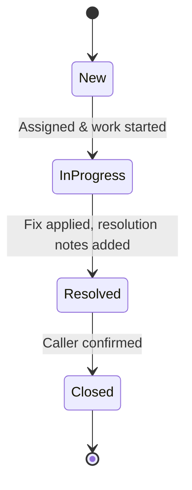

# Lab 4 — ServiceNow ITSM

A hands-on IT service management lab on a ServiceNow Personal Developer Instance: the full incident lifecycle, a service catalogue item, a change request with CAB approval, and management reports.

**Skills:** ServiceNow ITSM · incident management · service catalogue · change enablement · reporting
**Aligned with:** IT Support / Help Desk roles, ITIL® 4 Foundation

## Lab workflow

## 1. Incident lifecycle — INC0010003

- **Caller:** Abel Tuter · **Category:** Software / Email · **Short description:** "Outlook cannot connect to server"
- **Priority:** 3 – Moderate · **Assignment group:** Service Desk
- Walked the full lifecycle with work notes and resolution info at each stage:

## 2. Service catalogue — "New Laptop Request"

Catalogue item in the **Laptops** category with four variables:

| Variable | Type | Mandatory |
|----------|------|-----------|
| Requester Name | Single-line text | Yes |
| Business Justification | Multi-line text | Yes |
| Required By Date | Date | No |
| Laptop Model Preference | Select box — MacBook Pro / Dell XPS 15 / Lenovo ThinkPad X1 | No |

## 3. Change request — CHG0030001

- **Description:** Deploy MS24-001 security patch to production servers
- **Type:** Normal · **Category:** Software · **Risk:** Moderate · **Impact:** Medium
- Approval flow — approvals routed to CAB group members; approved and scheduled:

## 4. Reports

| Report | Table | Type | Grouping |
|--------|-------|------|----------|
| Incident Volume by Priority | Incident | Bar chart | Grouped by Priority |
| Open Incidents by Agent | Incident | Bar chart | Grouped by Assigned to, stacked by Active |

## What I'd do next

- Add an SLA to the incident table and a breach report.
- Build a Flow Designer flow that auto-assigns laptop requests to the hardware team.
- Add a knowledge base article for the Outlook fix and link it to the incident.
