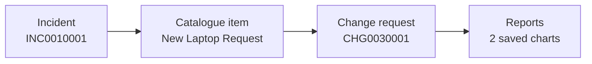
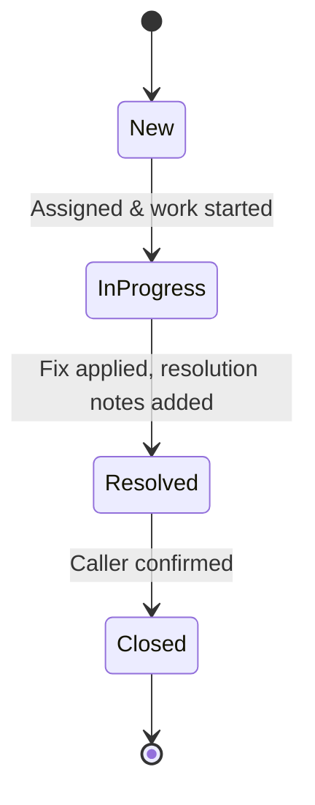
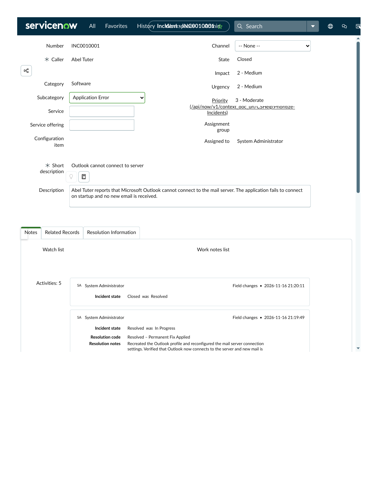
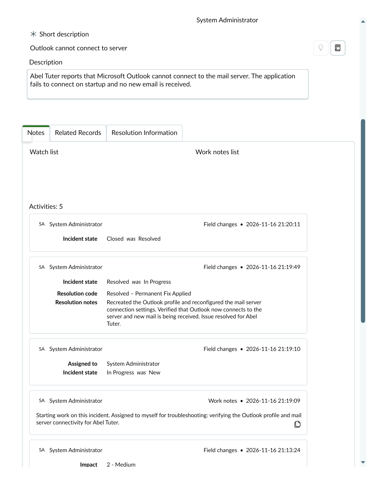
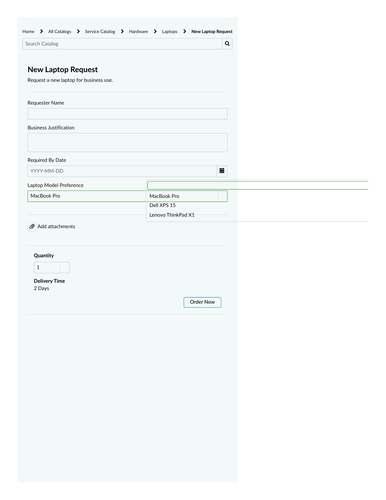
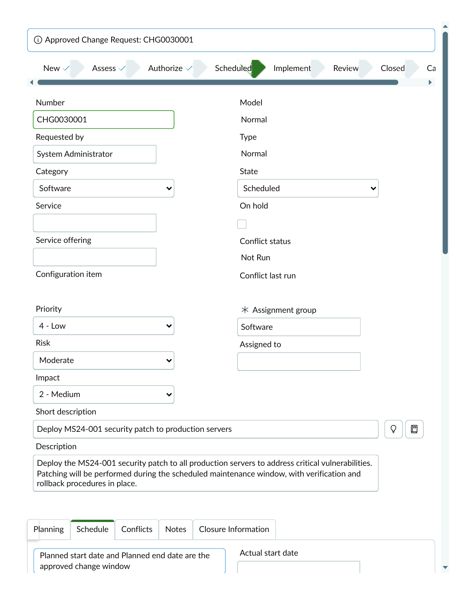
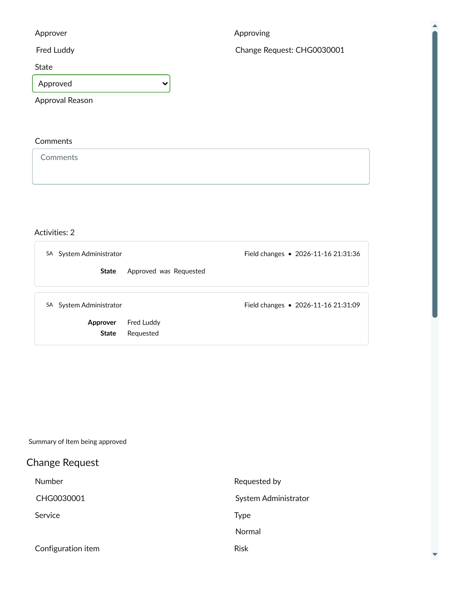
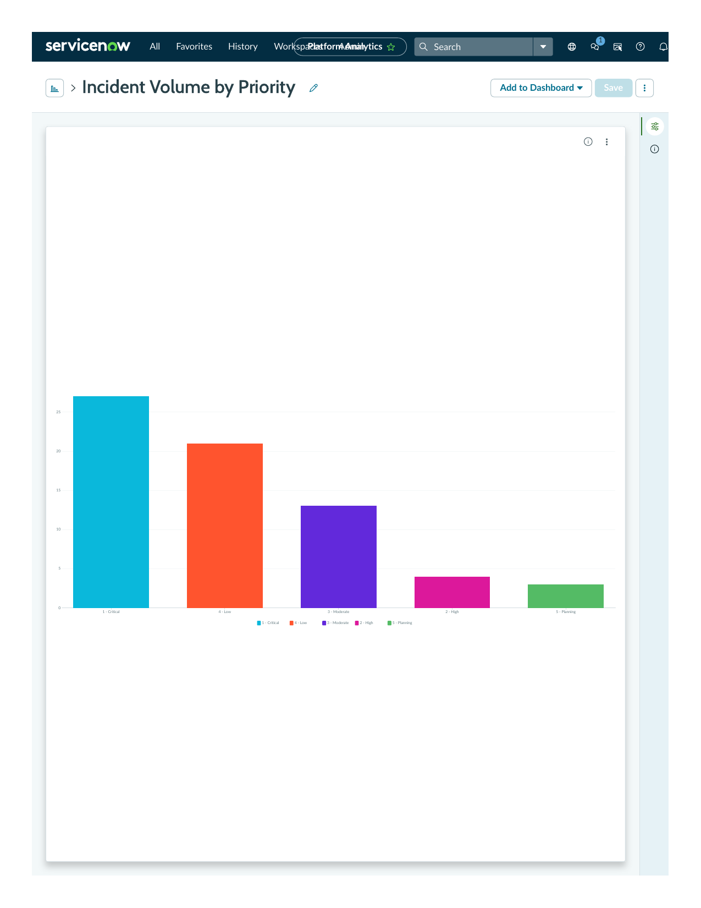
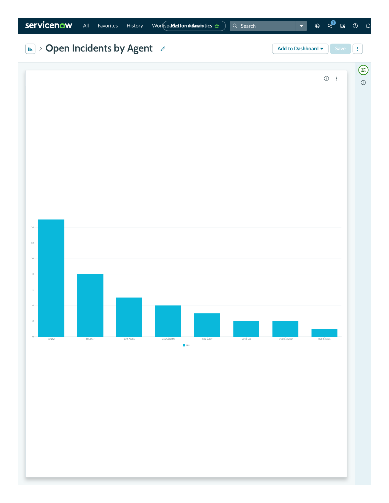

# Lab 4 — ServiceNow ITSM

A hands-on IT service management lab on a ServiceNow Personal Developer Instance: the full incident lifecycle, a service catalogue item, a change request with CAB approval, and management reports.

**Skills:** ServiceNow ITSM · incident management · service catalogue · change enablement · reporting
**Aligned with:** IT Support / Help Desk roles, ITIL® 4 Foundation

> Rebuilt Nov 17, 2026 on a fresh PDI — **dev446907.service-now.com** (Brazil release). The original instance (dev408678) was closed by ServiceNow after a month idle, so the lab was rebuilt from scratch on the new instance. The incident number changed; the change number is the same by coincidence (a fresh PDI counter starts at CHG0030001).

## Lab workflow

## 1. Incident lifecycle — INC0010001

- **Caller:** Abel Tuter · **Category:** Software / Application Error · **Short description:** "Outlook cannot connect to server"
- **Priority:** 3 – Moderate · **Assigned to:** System Administrator
- Walked the full lifecycle with work notes and resolution info at each stage:

Note: the original build used Subcategory Email, which does not exist under Software on this release — Application Error is the closest match.

## 2. Service catalogue — "New Laptop Request"

Catalogue item in the **Laptops** category with four variables:

| Variable | Type | Mandatory |
|----------|------|-----------|
| Requester Name | Single-line text | Yes |
| Business Justification | Multi-line text | Yes |
| Required By Date | Date | No |
| Laptop Model Preference | Select box — MacBook Pro / Dell XPS 15 / Lenovo ThinkPad X1 | No |

## 3. Change request — CHG0030001

- **Description:** Deploy MS24-001 security patch to production servers
- **Type:** Normal · **Category:** Software · **Risk:** Moderate · **Impact:** Medium
- Approval flow — approvals routed to CAB group members; approved and scheduled:

## 4. Reports

Built as Data Visualizations in Platform Analytics — the classic Reports form is read-only on this release.

| Report | Table | Type | Grouping |
|--------|-------|------|----------|
| Incident Volume by Priority | Incident | Bar chart | Grouped by Priority |
| Open Incidents by Agent | Incident | Bar chart | Grouped by Assigned to, stacked by Active |

## Screenshots

### 1. Incident INC0010001 — Closed

### 2. Incident activity — New → In Progress → Resolved → Closed

### 3. Catalogue item — "New Laptop Request" with all four variables

### 4. Change request CHG0030001 — Scheduled

### 5. Approval record — Approved

### 6. Report — Incident Volume by Priority

### 7. Report — Open Incidents by Agent

## What I'd do next

- Add an SLA to the incident table and a breach report.
- Build a Flow Designer flow that auto-assigns laptop requests to the hardware team.
- Add a knowledge base article for the Outlook fix and link it to the incident.
