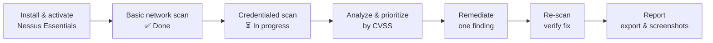

# Lab 5 — Nessus Vulnerability Scanning

A vulnerability management lab with Tenable Nessus Essentials (free tier): scan a Windows target, read and prioritize findings by CVSS, remediate, and verify with a re-scan.

**Skills:** Tenable Nessus Essentials · vulnerability scanning · CVSS scoring · remediation & verification
**Aligned with:** Vulnerability Analyst, Security Engineer, SOC Analyst roles

> **Status:** Basic (unauthenticated) scan complete. Credentialed scan, remediation, and re-scan in progress — this README is updated as each phase lands.

## Vulnerability management workflow

## Setup

- Nessus Essentials installed and activated (scanner runs locally; target scanned over the network and, for the credentialed phase, as `127.0.0.1` from the target host itself after external SMB (TCP 445) proved blocked between the scanner and the VM's public IP).

## Scan 1 — Basic network scan (unauthenticated) ✅

- **Target:** Windows Server 2025 VM (Azure)
- **Result:** 0 Critical · 0 High · **2 Medium** · 27 Informational · Authentication: failed (expected for an unauthenticated scan — it sees only what an outside attacker sees)

| Finding | CVSS | Notes |
|---------|------|-------|
| SSL Certificate Cannot Be Trusted | 6.5 (Medium) | The RDP service presents a self-signed certificate |
| SSL Self-Signed Certificate | 6.5 (Medium) | Same root cause — one fix clears both findings |

**Key lesson:** an unauthenticated scan shows the attacker's view. A credentialed scan logs in and inventories patches, software, and configuration — that's where the real findings are.

## Credentialed scan ⏳

- Windows credentials supplied to the scanner; Remote Registry service enabled on the target.
- Goal: authenticated results (missing patches, outdated software, weak configuration), prioritized by CVSS score.

## Remediation & re-scan ⏳

- Pick one Medium/High finding, apply the fix, re-scan, and confirm the finding is gone.
- _(Finding, fix, and before/after results added when complete.)_

## What I'd do next

- Schedule recurring scans and track findings over time.
- Compare authenticated vs unauthenticated results side by side.
- Add a second target (Linux) and contrast the finding profiles.
